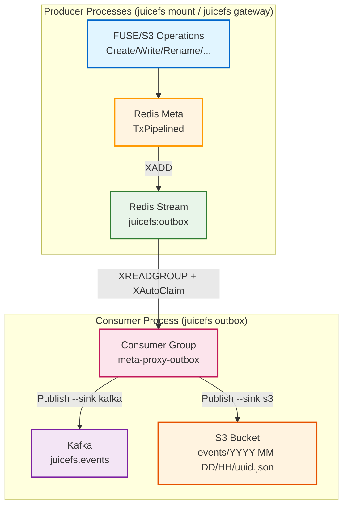

# JuiceFS Redis Streams Outbox Implementation

## Summary

Implemented a Redis Streams outbox pattern in JuiceFS to publish filesystem events to a configurable sink: a Kafka topic `juicefs.events` (default) or an S3-compatible bucket (one JSON object per event). This provides comprehensive event coverage including inode information and directory operations.

## Files Created

1. **pkg/meta/events.go** - Event types and `JuiceFsEvent` struct
2. **pkg/meta/outbox.go** - Redis Streams outbox with consumer group, retry logic, and dead-letter queue
3. **pkg/meta/watermill_kafka.go** - Kafka publisher using Watermill and Shopify/sarama
4. **pkg/meta/redis_event.go** - Event publishing helper functions for all filesystem operations
5. **cmd/outbox.go** - Standalone outbox command
6. **pkg/meta/event_filter.go** - Filtering rules and the moved-from-tmp → Created transformation
7. **pkg/meta/s3_sink.go** - S3 object sink with local spill buffer and backpressure

## Files Modified

1. **pkg/meta/config.go** - Added `OutboxConfig` structure with defaults
2. **pkg/meta/redis.go** - Integrated event publishing into 6 meta operations (writes to Redis stream only)
3. **cmd/flags.go** - Added CLI flags for outbox configuration
4. **cmd/mount.go** - Parse outbox-enabled flag
5. **cmd/main.go** - Added outbox command
6. **go.mod** - Added Kafka dependencies
7. **pkg/meta/events.go** - Extended `JuiceFsEvent` with `uuid`, `mtime` (Unix nanoseconds) and `xattrs` (whitelist) fields
8. **pkg/meta/redis_outbox.go** - `EventSink` interface, PEL reclaim via `XAutoClaim`, sink backpressure handling
9. **cmd/outbox.go** - Sink selector (`--sink kafka|s3`) with S3 flag set and validation

## Event Coverage

| Operation | Event Type | Function |
|-----------|-----------|----------|
| Create (file) | FileCreated | doMknod |
| Mkdir | DirCreated | doMknod |
| Rename (file) | FileMoved | doRename |
| Rename (dir) | DirMoved | doRename |
| Unlink | FileDeleted | doUnlink |
| Rmdir | DirDeleted | doRmdir |
| Write | FileWritten | doWrite |
| Fallocate | FileWritten | doFallocate |

## CLI Flags

### Mount Command (writes events to Redis stream)

```bash
--outbox-enabled                  # Enable writing events to Redis stream
--outbox-stream juicefs:outbox      # Redis stream name (default: juicefs:outbox)
```

### Gateway Command (writes events to Redis stream)

`juicefs gateway` accepts the same `--outbox-enabled` and `--outbox-stream` flags as mount. Events are emitted for operations performed through the S3 gateway. Object metadata passed as `X-Amz-Meta-*` headers is captured into the event's `xattrs` via the `s3-meta` xattr snapshot taken at the tmp → final rename (see [Event Format](#event-format)); gateway metadata support itself requires `--object-meta`.

### Outbox Command (reads from stream and publishes to the sink)

```bash
juicefs outbox REDIS-URL [options]

Common:
   --sink kafka                     # Sink type: kafka or s3 (default: kafka; env: JFS_OUTBOX_SINK)
   --outbox-stream juicefs:outbox   # Redis stream name (default: juicefs:outbox; env: JFS_OUTBOX_STREAM)
   --group meta-proxy-outbox        # Consumer group name (default: meta-proxy-outbox; env: JFS_OUTBOX_GROUP)
   --max-retries 10                 # Max retry attempts before dead-letter queue (default: 10; env: JFS_OUTBOX_MAX_RETRIES)
   --trim-max-len 10000             # Stream max length (default: 10000; env: JFS_OUTBOX_TRIM_MAX_LEN)
   --health-addr :9100              # Health endpoint address, empty to disable (default: :9100; env: JFS_OUTBOX_HEALTH_ADDR)
   --reclaim-min-idle 60s           # PEL idle time before a message is reclaimed via XAutoClaim (default: 60s; env: JFS_RECLAIM_MIN_IDLE)

Kafka (--sink kafka):
   --kafka-brokers kafka:9092       # Comma-separated brokers, required for sink kafka (env: JFS_KAFKA_BROKERS)
   --kafka-topic juicefs.events     # Kafka topic (default: juicefs.events; env: JFS_KAFKA_TOPIC)
   --kafka-user                     # Kafka SASL username for authentication (env: JFS_KAFKA_USER)
   --kafka-password                 # Kafka SASL password for authentication (env: JFS_KAFKA_PASSWORD)
   --kafka-cert                     # Kafka TLS certificate (base64 encoded) (env: JFS_KAFKA_CERT)
   --kafka-cert-file                # Path to Kafka TLS certificate file (env: JFS_KAFKA_CERT_FILE)
   --kafka-insecure-skip-verify     # Skip TLS certificate verification (env: JFS_KAFKA_INSECURE_SKIP_VERIFY)

S3 (--sink s3):
   --s3-endpoint URL                # S3 endpoint, required for sink s3 (env: JFS_S3_ENDPOINT)
   --s3-bucket NAME                 # Bucket name, required for sink s3 (env: JFS_S3_BUCKET)
   --s3-access-key KEY              # Access key (env: JFS_S3_ACCESS_KEY)
   --s3-secret-key KEY              # Secret key (env: JFS_S3_SECRET_KEY)
   --s3-session-token TOKEN         # Session token (env: JFS_S3_SESSION_TOKEN)
   --s3-prefix events/              # Object key prefix (default: events/; env: JFS_S3_PREFIX)
   --s3-region REGION               # S3 region, optional (env: JFS_S3_REGION)
   --s3-storage minio               # Object storage driver name for object.CreateStorage (default: minio; env: JFS_S3_STORAGE)
   --s3-spill-dir DIR               # Local spill directory; empty disables spill (env: JFS_S3_SPILL_DIR)
   --s3-spill-max-size 1073741824   # Total spill size limit in bytes (default: 1073741824; env: JFS_S3_SPILL_MAX_SIZE)
```

Flag consistency is validated at startup: `--sink kafka` requires `--kafka-brokers`, `--sink s3` requires `--s3-endpoint` and `--s3-bucket`, any other sink value fails the start.

## Sink Modes

### Kafka (default)

`--sink kafka` behaves exactly as before: every event that passes the filter rules is published as one JSON message to the Kafka topic.

### S3 Bucket

`--sink s3` stores every filtered event as a single JSON object in an S3-compatible bucket, enabling event consumers without a Kafka deployment. Full example:

```bash
juicefs outbox --sink s3 redis://localhost \
  --s3-endpoint http://localhost:9000 \
  --s3-bucket events-bucket \
  --s3-access-key minioadmin \
  --s3-secret-key minioadmin \
  --s3-prefix events/ \
  --s3-storage minio \
  --s3-region us-east-1 \
  --s3-session-token <token> \
  --s3-spill-dir /var/lib/juicefs/outbox-spill \
  --s3-spill-max-size 1073741824 \
  --reclaim-min-idle 60s
```

Only `--s3-endpoint` and `--s3-bucket` are required; spill flags and everything else are optional.

## Architecture



## Event Format

In S3 mode each object is one `JuiceFsEvent` JSON document (as-is, no envelope). The object key is `events/<YYYY-MM-DD>/<HH>/<uuid>.json` — date and hour are taken from the event `timestamp` in UTC, `<uuid>` is the RFC 4122 event uuid. Content-Type is not guaranteed.

| Field | Type | Notes |
|-------|------|-------|
| `type` | string | `FileCreated`, `FileDeleted`, `FileMoved`, `FileWritten`, `DirCreated`, `DirDeleted`, `DirMoved` |
| `timestamp` | time | Event time |
| `volume` | string | JuiceFS volume name |
| `uid`, `gid` | number | Caller identity |
| `subdir` | string | Omitted when empty |
| `inode`, `parent` | number | Inode and parent inode |
| `name`, `path` | string | `path` omitted when empty |
| `old_path` | string | Previous full path, set for move events |
| `size` | number | Resulting file length, set for write events |
| `mode` | number | Permission mode, set for create events |
| `uuid` | string | RFC 4122, generated for every emitted event (also for legacy events without one, before the first delivery attempt) |
| `mtime` | number | File modification time in Unix nanoseconds (seconds × 10⁹ + nanoseconds part) |
| `xattrs` | object | Whitelist only — currently the single key `s3-meta`: the JSON document of gateway `X-Amz-Meta-*` metadata, snapshotted from the inode at rename time; omitted when absent |

Zero-valued optional fields are omitted (`omitempty`), so JSON produced by earlier versions is unchanged. Old consumers ignore the new fields (standard `encoding/json` behavior), and legacy JSON without them unmarshals with zero extension fields.

## Delivery Semantics

- **At-least-once.** A stream message is acknowledged (XACK) only after successful publish to the sink or after a successful spill write (S3 mode, see below). Publishing failures increment a per-message retry counter; when it reaches `--max-retries`, the payload moves to the dead-letter queue (`<stream>:dead`) and the original message is acknowledged.
- **Duplicates are possible** (retries and reclaim reprocess messages). In S3 mode the object key is the event uuid, so redelivery overwrites the same object — duplicates are idempotent.
- **No ordering guarantee.** Consumers should apply latest-wins per `(volume, path or inode)` using the event `timestamp` as the tiebreak and deduplicate by `uuid`.
- **PEL reclaim.** Messages stuck in the consumer group's pending entries list (PEL) longer than `--reclaim-min-idle` (default 60s) are claimed with `XAutoClaim` and processed again by the same code path as new messages. Previously a failed message could stay in the PEL forever; now retries and the dead-letter queue are actually reachable.

## Spill and Backpressure (S3 mode)

When the bucket is unavailable and `--s3-spill-dir` is set:

- Events are buffered locally as JSONL chunks (one event per line); each event is appended with a single write to the open chunk, and the stream message is acknowledged right after the successful spill write (ack-after-spill): an event is either fully in the chunk and acked, or not written and stays in PEL (a torn tail after a crash is dropped by the drain with a WARN and the event is redelivered). New chunks are created atomically (write to a temporary file + rename) and rotate at a 64 MiB threshold.
- The total spill size is limited by `--s3-spill-max-size` (default 1073741824 bytes).
- When the limit is exhausted, the sink enters **backpressure**: the consumer stops reading new messages and stops reclaiming PEL entries (so in-flight messages are not failed into the DLQ behind an outage), `/health` returns 503, an ERROR is logged — but the process stays alive and no events are dropped. Backpressure is cleared only by a successful Put: with an empty spill the drain attempt performs a probe put to `<prefix>/.probe/<uuid>.json` (outside the date prefixes — not an event, ignored by consumers, cleaned by the bucket lifecycle rule).
- Once the storage recovers, the spill drains automatically: the consume loop attempts the drain each tick whenever the spill is non-empty (and each successful publish drains first), FIFO by chunk file. A partially drained chunk resumes from an in-memory cursor — a failed attempt stops at the failing line without rewriting the chunk. Ordering is still not guaranteed.
- Spill survives restart: chunks found at startup are drained best-effort on the next run. The cursor is not persisted, so a restart re-drains each chunk from its beginning — re-writing already delivered objects is idempotent by uuid key.
- Without `--s3-spill-dir`, an undelivered event keeps its message in the PEL with retries and reclaim (eventually the dead-letter queue); the process keeps running.

## Health Endpoint

`GET /health` on `--health-addr` (default `:9100`):

- **Kafka mode** — unchanged: 200 with body `ok` while the consumer is running and Redis ping succeeds, 503 with body `unhealthy` otherwise.
- **S3 mode** — additionally 503 while the sink is in backpressure (spill limit exhausted); while the spill is still buffering (limit not reached) the endpoint stays 200 even if the bucket is down.

## Key Features

1. **Transactional**: Events added inside `TxPipelined` callbacks for atomicity with metadata operations
2. **Consumer Group**: Uses Redis consumer groups for reliable message processing
3. **Retry Logic**: Tracks retry counts, moves to dead-letter queue after 10 failures
4. **Bounded Stream**: XTRIM keeps stream under 10000 entries
5. **Context-Aware**: Extracts Uid/Gid from `Context` parameter
6. **PEL Reclaim**: `XAutoClaim` re-delivers messages stuck in the PEL longer than `--reclaim-min-idle` (at-least-once in practice)
7. **Sink Selection**: `--sink kafka` (default) or `--sink s3` with local spill buffering and backpressure

## Usage

### 1. Mount or gateway with outbox enabled (writes to Redis stream)

```bash
# Default stream name
juicefs mount --outbox-enabled redis://localhost /mnt/juicefs

# Custom stream name
juicefs mount --outbox-enabled --outbox-stream my-events redis://localhost /mnt/juicefs

# Gateway: same flags; gateway metadata (X-Amz-Meta-*) requires --object-meta
juicefs gateway --outbox-enabled --object-meta redis://localhost /mnt/juicefs
```

### 2. Start outbox separately (reads from stream, publishes to the sink)

```bash
# Kafka (default sink)
juicefs outbox redis://localhost \
  --kafka-brokers kafka:9092 \
  --kafka-topic juicefs.events

# S3 bucket
juicefs outbox --sink s3 redis://localhost \
  --s3-endpoint http://localhost:9000 \
  --s3-bucket events-bucket \
  --s3-access-key minioadmin \
  --s3-secret-key minioadmin \
  --s3-spill-dir /var/lib/juicefs/outbox-spill

# With SASL authentication
juicefs outbox redis://localhost \
  --kafka-brokers kafka:9092 \
  --kafka-user myuser \
  --kafka-password mypassword

# With TLS certificate
juicefs outbox redis://localhost \
  --kafka-brokers kafka:9092 \
  --kafka-cert-file /etc/ssl/certs/ca.crt
```

### 3. Multiple consumers for high availability

```bash
# Consumer 1
juicefs outbox redis://localhost \
  --kafka-brokers kafka:9092 \
  --kafka-user myuser \
  --kafka-password mypassword \
  --group meta-proxy-outbox

# Consumer 2 (same group, load balanced)
juicefs outbox redis://localhost \
  --kafka-brokers kafka:9092 \
  --kafka-user myuser \
  --kafka-password mypassword \
  --group meta-proxy-outbox
```

## Build Verification

```bash
go build ./...  # ✅ Passes
go vet ./cmd/...  # ✅ Passes
```
